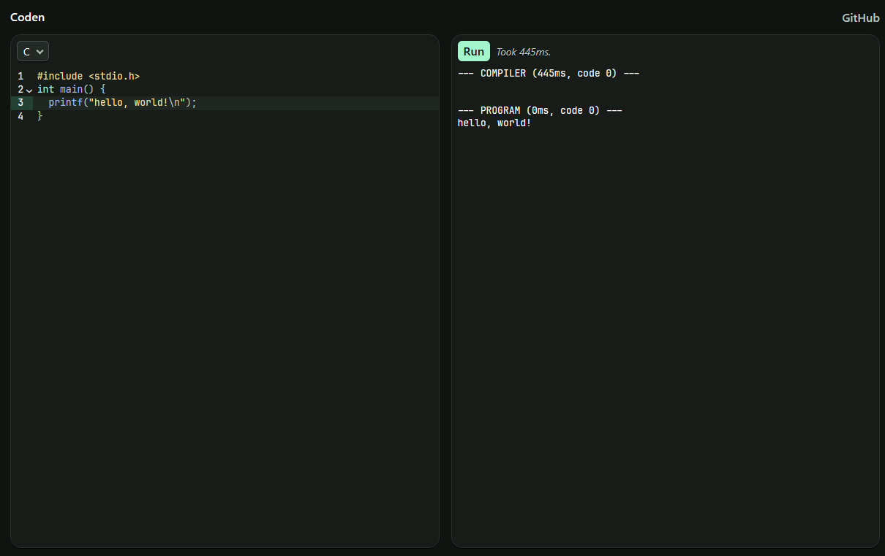

# coden

A web service for running code within a virtual machine.



- Try it out: https://coden.lukadev.me/
- API Documentation: https://coden.lukadev.me/docs

> [!NOTE]
> The hosted instance runs on a cheap VPS. It might not always be reliable,
> especially if a lot of people are using it!

## How to host this?

The easiest way to host this is via Docker:

```
docker run -it --rm \
    --device /dev/kvm \
    --cap-add SYS_ADMIN \
    --security-opt seccomp=unconfined \
    -p 8080:8080 \
    -e RUST_LOG=debug \
    ghcr.io/lukadev-0/coden
```

You can also use the Nix flake included in this repository. It exposes a
package that includes all the required dependencies. It is recommended to
use our binary cache ([lukadev.cachix.org](https://lukadev.cachix.org/))
to avoid compiling everything.

```sh
sudo nix run github:lukadev-0/coden
```

We also provide a NixOS module:

```nix
{
    imports = [ coden.nixosModules.default ];
    service.coden.enable = true;
}
```
